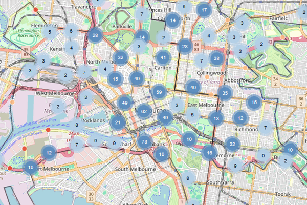

:::: {.project-entry}
::: {.project-image}
[{fig-alt="Map of road crashes in central Melbourne from the roadcrashVIC app"}](roadcrashVIC/index.qmd)
:::
::: {.project-text}
## [roadcrashVIC](roadcrashVIC/index.qmd)
[Road safety]{.project-tag} [Maps]{.project-tag} [Victoria]{.project-tag}

An R package and Shiny app for exploring road crashes in Victoria, Australia, from 2012 to 2025.

[ Launch the app](roadcrashVIC/app.qmd){.btn .btn-sm .about-link}
[ Source code](https://github.com/EduVit/roadcrashVIC){.btn .btn-sm .about-link target="_blank"}
[ Documentation](https://eduvit.github.io/roadcrashVIC){.btn .btn-sm .about-link target="_blank"}
:::
::::
