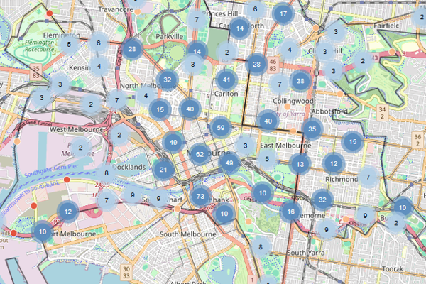

:::: {.project-entry}
::: {.project-image}
[{fig-alt="Map of road crashes in central Melbourne from the roadcrashVIC app"}](roadcrashVIC/index.qmd)
:::
::: {.project-text}
## [roadcrashVIC](roadcrashVIC/index.qmd)

An R package and Shiny app for exploring road crashes in Victoria, Australia, from 2012 to 2025.

[ Source code](https://github.com/ETC5523-2026/etc5523-assignment-4-eduvit){.btn .btn-sm .about-link target="_blank"}
[ Documentation](https://etc5523-2026.github.io/etc5523-assignment-4-eduvit/){.btn .btn-sm .about-link target="_blank"}
:::
::::
