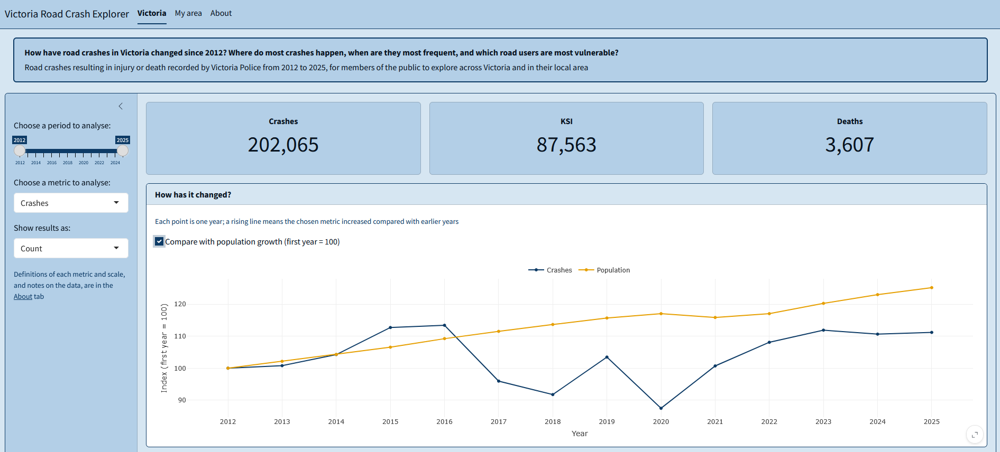
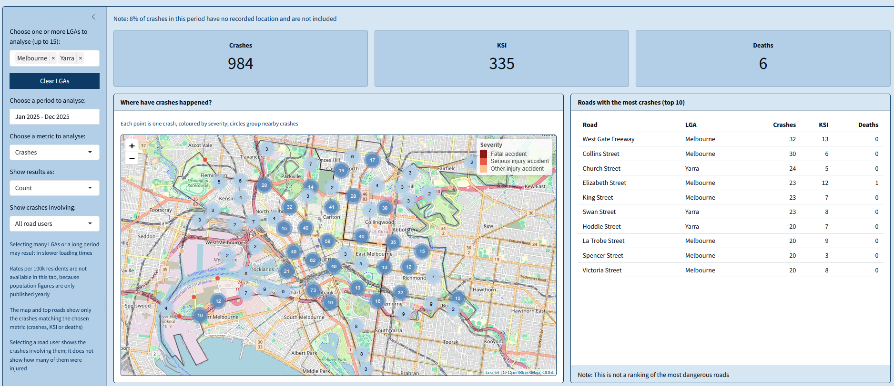

`roadcrashVIC` is an R package and Shiny app for exploring road crashes in Victoria, Australia, from 2012 to 2025: how they have changed over time, where and when they happen, and who is involved.

## Who it is for

The app is designed for members of the public who want to understand road safety across the state or in their local area. It helps answer one question: **how have road crashes in Victoria changed since 2012, where do most crashes happen, when are they most frequent, and which road users are most vulnerable?**

## What the package includes

- Cleaned data on every Victorian road crash that injured or killed at least one person, from 2012 to 2025, with local government area (LGA) boundaries and resident population;
- Functions to filter crashes by date, summarise them by any variable and calculate rates per 100,000 residents;
- A Shiny app with two tabs: **Victoria**, for state-wide trends, times, road users and a map of LGAs; and **My area**, for crashes in one or more LGAs, including the location of each crash.

## Preview

{#fig-victoria}

{#fig-my-area}

## Try it

The package requires R 4.1.0 or later. Install it from GitHub and launch the app with:

``` r
# install.packages("remotes")
remotes::install_github("ETC5523-2026/etc5523-assignment-4-eduvit")

library(roadcrashVIC)
run_app()
```

## Data sources

- Crashes: [Victorian road crash data](https://discover.data.vic.gov.au/dataset/victoria-road-crash-data), Department of Transport and Planning
- LGA boundaries: [Vicmap Admin](https://discover.data.vic.gov.au/dataset/vicmap-admin-local-government-area-lga-polygon-aligned-to-property), Department of Transport and Planning
- Population: [Regional population](https://www.abs.gov.au/statistics/people/population/regional-population/2024-25), Australian Bureau of Statistics

All sources are licensed under [CC BY 4.0](https://creativecommons.org/licenses/by/4.0/).
